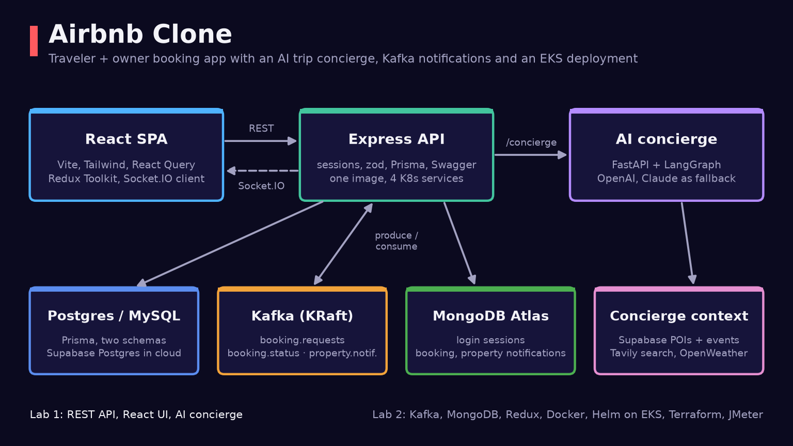
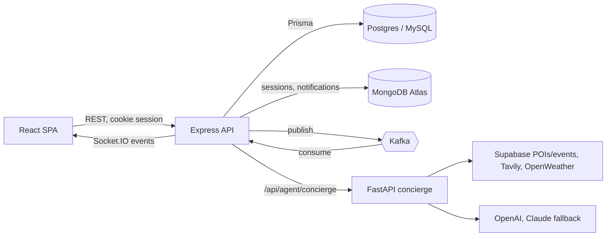

# Airbnb Clone

A full-stack Airbnb-style booking app for travelers and hosts, with an AI trip concierge, Kafka-driven live notifications and a Kubernetes deployment on AWS EKS. Built for DATA 236 (Lab 1 and Lab 2).



## What it does

- **Travelers** sign up, search properties by location, dates and guests, save favorites, request bookings, cancel them and see past trips.
- **Owners** list and edit properties (photos go to Firebase Storage), accept or cancel booking requests and get a dashboard of their listings and bookings.
- **AI concierge**: a floating panel sends the traveler's booking, preferences and a free-text question to a LangGraph workflow. It gathers context (Supabase properties, POIs and events, Tavily web search, OpenWeather forecast) and returns a day-by-day itinerary, activity cards, restaurant picks and a weather-aware packing list as validated JSON.
- **Live updates**: booking requests reach the owner and status changes reach the traveler in real time through Kafka and Socket.IO, with a notification bell and toasts in the UI.

## Lab 1 vs Lab 2

| | Lab 1 | Lab 2 |
|---|---|---|
| Backend | One Express REST API (auth, profiles, properties, bookings, favorites) on Prisma | Same code, deployed as four services (traveler, owner, property, booking) on EKS |
| Data | Postgres (Supabase) or MySQL through Prisma | Adds MongoDB Atlas for login sessions and notifications |
| Messaging | None | Kafka topics `booking.requests`, `booking.status`, `property.notifications`; Socket.IO fan-out |
| Frontend | React + React Query | Adds Redux Toolkit slices for notifications and socket state |
| AI | FastAPI + LangGraph concierge | Same service, containerised and deployed alongside the API |
| Ops | Local dev servers | Docker Compose, Helm chart, Terraform for EKS/ECR/IAM, JMeter load test plan |

## How it works



**Booking flow.** A traveler's booking request is written through Prisma, then published to `booking.requests`. A Kafka consumer in the API stores a notification in MongoDB and emits `booking:request` to the owner's Socket.IO room. When the owner accepts or cancels, the same path runs through `booking.status` back to the traveler. Property create/update events go to `property.notifications` for subscribed travelers.

**Auth.** `express-session` with bcrypt password hashes and an httpOnly cookie (`airbnb.sid`, one-hour TTL). Sessions are stored in MongoDB through `connect-mongo` when `MONGO_SESSION_URI` is set, otherwise in memory. The Socket.IO server reuses the session middleware to authenticate sockets.

**Concierge.** A two-node LangGraph graph (`gather_context` then `plan_itinerary`). The planner prompts the model with the response JSON schema, repairs malformed JSON, tries OpenAI first and falls back to Claude when an Anthropic key is set. The endpoint has a sliding-window rate limit of 20 requests per minute and optional LangSmith tracing.

**Deployment.** `scripts/build-and-push.sh` builds the backend image once and pushes it as four ECR repositories, plus the agent and frontend images. The Helm chart (`k8s/helm/airbnb`) creates Deployments, Services, HPAs (1 to 3 replicas at 70% CPU) and an ALB ingress; nginx in the frontend container routes `/api/*` paths to the matching service. Kafka runs in its own namespace as a single KRaft broker. Terraform in `aws/` provisions the EKS cluster, node group, IAM roles, add-ons and ECR repositories.

## Tech stack

- **Frontend:** React 19, Vite, Tailwind CSS + daisyUI, React Router, TanStack Query, Redux Toolkit, Socket.IO client, Firebase Storage
- **Backend:** Node 20, Express, Prisma (PostgreSQL and MySQL schemas), zod, express-session, connect-mongo, KafkaJS, Socket.IO, Swagger UI
- **AI service:** Python 3.12, FastAPI, LangGraph, LangChain (OpenAI, Anthropic), Tavily, OpenWeather, Supabase, uv
- **Infra:** Docker Compose, Confluent Kafka (KRaft) + Kafka UI, Helm, AWS EKS, ECR, ALB, Terraform, Apache JMeter

## Quickstart

You need Node 20, Python 3.12 with [uv](https://docs.astral.sh/uv/), Docker, a Postgres or MySQL database and, optionally, a MongoDB Atlas cluster, an OpenAI key and a Firebase project.

1. Configure the services:

   ```bash
   cp backend/.env.example backend/.env      # DATABASE_URL, SESSION_SECRET, MONGO_SESSION_URI, KAFKA_BROKER_URL
   cp frontend/.env.example frontend/.env    # Firebase web config for photo uploads
   ```

   Set `DATABASE=pg` in `backend/.env` for Postgres (the committed migrations target PostgreSQL) or `DATABASE=mysql` for MySQL. Create `agent-service/.env` with at least `OPENAI_API_KEY`; `ANTHROPIC_API_KEY`, `TAVILY_API_KEY`, `TAVILY_ENABLED`, `WEATHER_API_KEY`, `SUPABASE_URL` and `SUPABASE_SERVICE_ROLE_KEY` are optional.

2. Start Kafka and create the topics:

   ```bash
   docker compose up -d kafka kafka-ui        # Kafka UI at http://localhost:8080
   bash scripts/kafka/bootstrap-topics.sh
   ```

3. Run the apps:

   ```bash
   (cd backend && npm install && npm run prisma:generate && npm run prisma:migrate)
   (cd frontend && npm install)
   make dev                                   # API on :4000, Vite dev server on :5173
   (cd agent-service && uv sync && uv run uvicorn app.main:app --reload --port 8000)
   ```

   Or build and run everything in containers with `docker compose up --build` (frontend on http://localhost:3000).

API docs are served at http://localhost:4000/api-docs and the concierge's OpenAPI docs at http://localhost:8000/docs.

For the EKS deployment see [docs/kubernetes-deployment.md](docs/kubernetes-deployment.md), [aws/README.md](aws/README.md) and [k8s/helm/airbnb/README.md](k8s/helm/airbnb/README.md). Secrets for Helm go in a gitignored `k8s/helm/airbnb/values-secret.yaml` (see `values-secret.example.yaml`). The JMeter plan and runner are in [jmeter/](jmeter/README.md).

## Project layout

```
backend/          Express API: routes, controllers, services, Prisma schemas and migrations,
                  Kafka producers/consumers (src/messaging), Socket.IO server (src/realtime), OpenAPI spec
frontend/         React SPA: pages (traveler, owner, auth), hooks, Redux store, nginx configs, Dockerfiles
agent-service/    FastAPI concierge: LangGraph planner, context service, OpenAI/Claude/Tavily/weather/Supabase clients
k8s/              Helm chart for all services, Kafka + Kafka UI manifests, topic job
aws/              Terraform for EKS, node group, IAM, ECR; deployment helper scripts
scripts/          Build/push, Helm deploy, Kafka deploy and topic bootstrap, cluster recreate
jmeter/           Load test plan and runner script
docs/             Architecture notes and Kubernetes deployment guide
```

## Team

Built by a two-person team for DATA 236:

- [Shravankumar Nagarajan](https://github.com/shra012): backend API and Prisma schema, React frontend, the AI concierge service, Kafka, MongoDB sessions/notifications, Socket.IO and Redux wiring, Docker Compose, the Helm chart and Terraform.
- [shreyas-07](https://github.com/shreyas-07): AWS deployment work (Terraform and EKS fixes, Kafka-on-EKS deploy, cluster recreate and update scripts, frontend nginx and Dockerfile changes), the JMeter load test and fixes to traveler/booking services and image uploads.

## License

No license file is included in this repository.
